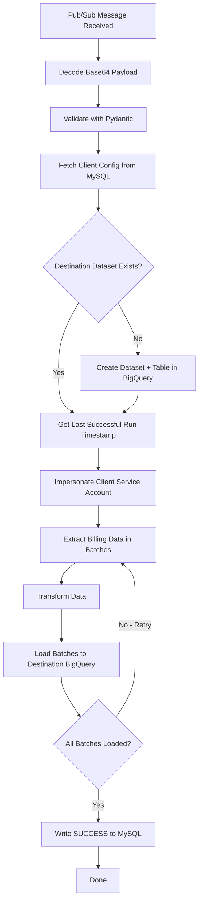

<div align="center">

# BigQuery Cross-Environment Billing ETL Pipeline

<p align="center">
  
  
  
  
  
  
  
  
</p>

A production-grade, serverless ETL pipeline that extracts GCP billing data from client BigQuery environments using service account impersonation, applies business transformations, and loads the results into a centralized internal BigQuery instance with a full audit trail tracked in MySQL.

</div>

---

## How It Works

Each ETL run is triggered via a **Google Cloud Pub/Sub message** delivered as an HTTP request to a Cloud Function. The service decodes the message, fetches the client's billing configuration from MySQL, impersonates the client's GCP service account, extracts billing data in paginated batches, and loads it into the internal BigQuery environment. Every step including retries, failures, and successes is logged to a MySQL status table for complete observability.

---

## Architecture

```
                    ┌─────────────────────────────┐
                    │     Google Cloud Pub/Sub     │
                    │     (HTTP trigger payload)   │
                    └──────────────┬──────────────┘
                                   │
                                   ▼
                    ┌─────────────────────────────┐
                    │       Cloud Function         │
                    │   Decode → Validate          │
                    │   → Orchestrate ETL          │
                    └───────┬─────────────┬────────┘
                            │             │
               ┌────────────▼──┐    ┌─────▼──────────────────────┐
               │    MySQL      │    │    Client GCP Environment   │
               │               │    │  (Impersonated Svc Account) │
               │ • Org config  │    │   BigQuery Source Dataset   │
               │ • ETL status  │    └─────────────┬──────────────┘
               │ • Step flags  │                  │
               └───────────────┘          Extract (batched)
                                                  │
                                                  ▼
                                   ┌──────────────────────────────┐
                                   │   Internal GCP Environment   │
                                   │  BigQuery Destination Dataset │
                                   │   (per-org isolated tables)  │
                                   └──────────────────────────────┘
```

---

## Key Design Decisions

**Service Account Impersonation** — The pipeline never stores client credentials directly. Instead, a source service account impersonates the client's target service account at runtime, scoped to the minimum required permissions and limited to a 1-hour lifetime.

**Incremental Extraction** — Every successful run records its `end_date_time` in MySQL. The next run picks up from that timestamp, ensuring no data is reprocessed and no gaps are introduced.

**Batched Processing** — Both extraction and loading operate in configurable batches (default: 1000 rows). This keeps memory usage predictable regardless of dataset size.

**Per-Org Dataset Isolation** — Each organization's billing data lands in a dedicated BigQuery dataset and table (`org_{id}_standard_export`), keeping tenants fully isolated.

**Retry with Exponential Backoff** — The ETL loop retries up to 3 times on failure, with randomized exponential backoff to handle transient GCP rate limits gracefully.

**Audit Trail** — Every ETL run writes `IN_PROGRESS`, `SUCCESS`, or `FAILED` status to MySQL with a timestamp, giving full visibility into pipeline health without needing external monitoring tools.

---

## ETL Flow



---

## Tech Stack

| Layer | Technology |
|---|---|
| Runtime | Python 3.9+, Google Cloud Functions |
| Trigger | Google Cloud Pub/Sub (HTTP push) |
| Source Data | Google BigQuery (client environment) |
| Destination | Google BigQuery (internal environment) |
| Auth | GCP Service Account Impersonation |
| Audit & Config | MySQL via SQLAlchemy |
| Validation | Pydantic v2 |
| Logging | Structured JSON (GCP Cloud Logging compatible) |

---

## Database Schema

### `billing_etl_status` — Audit trail for every ETL run

```sql
CREATE TABLE billing_etl_status (
    id            INT AUTO_INCREMENT PRIMARY KEY,
    org_id        INT NOT NULL,
    project_id    VARCHAR(255) NOT NULL,
    status        ENUM('IN_PROGRESS', 'SUCCESS', 'FAILED') NOT NULL,
    end_date_time TIMESTAMP NULL,
    created_at    TIMESTAMP DEFAULT CURRENT_TIMESTAMP
);
```

### `billing_alerts_setting` — Per-org client billing configuration

```sql
CREATE TABLE billing_alerts_setting (
    id                        INT AUTO_INCREMENT PRIMARY KEY,
    org_id                    INT NOT NULL,
    projectid                 VARCHAR(255),
    billingdataset            VARCHAR(255),
    tableid                   VARCHAR(255),
    pulsebillingdataset       VARCHAR(255),
    pulsetableid              VARCHAR(255),
    customerserviceaccountid  VARCHAR(255)
);
```

### `user_stepper_form_step_status` — Onboarding step tracking

```sql
CREATE TABLE user_stepper_form_step_status (
    id             INT AUTO_INCREMENT PRIMARY KEY,
    org_id         INT NOT NULL,
    stepid         INT NOT NULL,
    step_completed BOOLEAN DEFAULT FALSE
);
```

---

## Environment Variables

```bash
# MySQL
DB_HOST=your-mysql-host
DB_USER=your-db-user
DB_PASSWORD=your-db-password
DB_NAME=your-db-name

# GCP
PROJECT_ID=your-internal-gcp-project-id
REGION=us-central1
```

> Service account key is mounted at `/secret/BILLING_ALERTS_SOURCE_SA_KEY` at runtime via GCP Secret Manager volume mount or equivalent.

---

## Deployment

### Google Cloud Functions

```bash
gcloud functions deploy billing-etl \
    --runtime python39 \
    --trigger-http \
    --entry-point main \
    --memory 512MB \
    --timeout 540s \
    --set-env-vars PROJECT_ID=your-project-id,REGION=us-central1
```

### Google Cloud Run

```bash
gcloud run deploy billing-etl \
    --source . \
    --platform managed \
    --region us-central1 \
    --memory 1Gi \
    --cpu 1 \
    --max-instances 10
```

---

## Error Handling

| Scenario | Behaviour |
|---|---|
| Invalid Content-Type | Returns `415` immediately |
| Malformed Pub/Sub payload | Returns `400` with specific field error |
| Missing client config in DB | Logs error, exits gracefully |
| BigQuery rate limit hit | Exponential backoff, up to 3 retries per batch |
| ETL loop exhausts all retries | Writes `FAILED` status to MySQL with timestamp |
| Dataset not found | Auto-creates dataset and table, then continues |
| Unhandled exception | Returns `500`, full traceback printed to logs |

---

## Logging

All logs are emitted as structured JSON, compatible with GCP Cloud Logging severity filters out of the box.

```json
{ "severity": "info",  "message": "Extracted 1000 rows for org_id: 42 in current batch" }
{ "severity": "error", "message": "Attempt 2 failed: 503 Service Unavailable" }
{ "severity": "info",  "message": "ETL succeeded for org_id: 42" }
```

---

## Local Development Notes

This service is designed to run on GCP infrastructure. To run or test locally:

- GCP connectivity and valid service account credentials are required for BigQuery operations.
- MySQL must be accessible from your local environment.
- Set all environment variables listed above before running.
- The Pub/Sub trigger can be simulated by sending a POST request with a base64-encoded JSON payload matching the `BillingETLMessage` schema.

---

## License

© 2025 Chirag Gupta. Licensed under the [MIT License](./LICENSE). Please credit if reused.